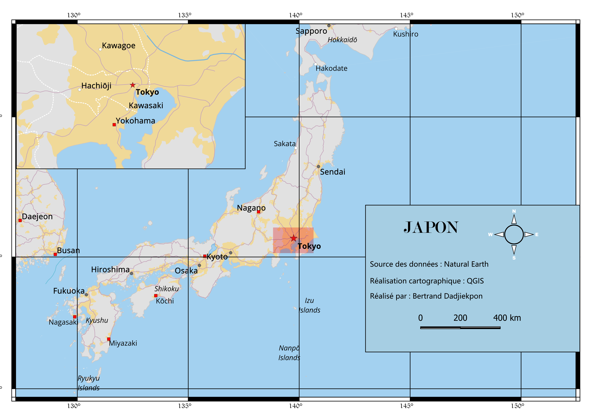

# Japan Map with Tokyo Inset — QGIS

## Project Overview

This project is my first practical cartographic project created with QGIS as part of my learning journey in Geographic Information Systems (GIS).

The objective was to create a map of Japan featuring a detailed inset map of Tokyo while exploring the main cartographic layout tools available in QGIS.

## Work Completed

- Geographic layer organization and management.
- Coordinate Reference System (CRS) configuration.
- Creation of a main map and a Tokyo inset map.
- Addition of a geographic coordinate grid.
- Integration of a north arrow and a scale bar.
- Map layout design and export.

## Software

- QGIS

## Data Source

- Natural Earth

## Project Level

Beginner — First practical GIS cartographic project.

## Future Improvements

This project marks the beginning of my journey in geomatics. Future projects will explore thematic mapping, spatial analysis, remote sensing, and geospatial programming.

## Project Preview

